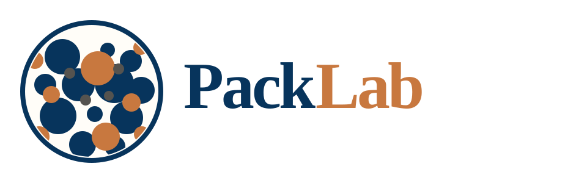
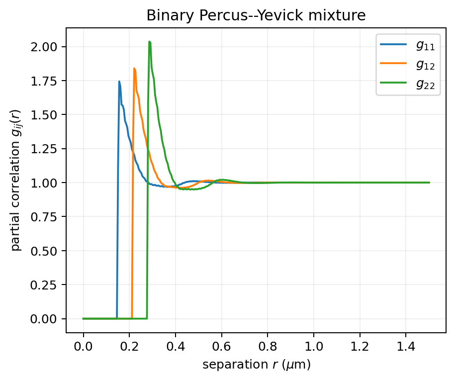

PackLab
========

.. list-table::
   :width: 100%
   :widths: 35 65
   :header-rows: 1

   * - Badge
     - Status
   * - Python versions
     - |mps-python|
   * - Documentation
     - |mps-docs|
   * - Tests
     - |mps-ci| |mps-coverage|
   * - PyPI
     - |mps-pypi| |mps-downloads|
   * - Conda
     - |mps-conda| |mps-conda-downloads| |mps-conda-release|
   * - Zenodo DOI
     - |mps-zenodo|

PackLab computes correlations and generates particle configurations for three-dimensional hard-sphere mixtures.

Use the Percus–Yevick approximation to compute pair correlations and structure
factors for an equilibrium hard-sphere mixture. For explicit particle
positions, choose a sampling method that matches the physical process:

* Random sequential adsorption (RSA) deposits spheres without overlap.
  Accepted spheres stay in place, so the packing retains its deposition history.
* Metropolis Monte Carlo moves spheres at fixed volume and composition.
  Check equilibration and autocorrelation before using samples for equilibrium averages.

Installation
------------

Requires Python ``>=3.10``.

.. code-block:: console

   $ python -m pip install PackLab

Install from the ``martinpdes`` Conda channel:

.. code-block:: console

   $ conda install -c martinpdes packlab

For an editable source installation:

.. code-block:: console

   $ git clone https://github.com/MartinPdeS/PackLab.git
   $ cd PackLab
   $ python -m pip install -e .

Compute pair correlations in a binary mixture
---------------------------------------------

Mix spheres of radius 75 nm and 140 nm in a 70:30 number ratio at a total
volume fraction of 0.25. The example uses an automatic wavenumber grid and
plots the pair correlation for each combination of species.

.. code-block:: python

   """
   Binary-mixture Percus--Yevick pair correlations
   ================================================

   Evaluate the three distinct partial pair correlations of a binary hard-sphere
   mixture.  The hard-core cutoffs occur at the corresponding contact distances
   :math:`2a_1`, :math:`a_1+a_2`, and :math:`2a_2`.
   """

   import matplotlib.pyplot as plt
   import numpy as np

   from PackLab import analytical, ureg

   # %%
   # Define and solve a binary equilibrium reference
   # ------------------------------------------------

   radii = np.array([75, 140]) * ureg.nanometer
   domain = analytical.PercusYevickDomain(
       size=50 * ureg.micrometer,
       radii=radii,
       volume_fraction=0.25,
       number_fractions=np.array([0.7, 0.3]),
   )
   distances = np.linspace(0.0, 1.5, 300) * ureg.micrometer
   result = analytical.PercusYevickSolver(
       densities=domain.particle_densities_per_radius,
       radii=domain.radii,
       wavenumber="auto",
   ).compute(distances)

   # %%
   # Compare like- and unlike-species correlations
   # ----------------------------------------------

   figure, axis = plt.subplots(figsize=(6.5, 4))
   for i, j, label in ((0, 0, r"$g_{11}$"), (0, 1, r"$g_{12}$"), (1, 1, r"$g_{22}$")):
       _ = axis.plot(distances.to("micrometer").magnitude, result.g[i, j], label=label)

   _ = axis.set(
       xlabel=r"separation $r$ ($\mu$m)",
       ylabel=r"partial pair correlation $g_{ij}(r)$",
       title="Binary Percus--Yevick hard-sphere mixture",
   )
   _ = axis.legend()
   axis.grid(alpha=0.2)
   figure.tight_layout()

   The three curves have different contact distances. Two small spheres touch
   at 150 nm, a mixed pair at 215 nm, and two large spheres at 280 nm.

Documentation
-------------

Use the `PackLab documentation <https://martinpdes.github.io/PackLab/docs/latest/index.html>`__ to work through
examples and look up the inputs and return values of individual functions.

Optical scattering
------------------

Install the PyMieSim integration with ``python -m pip install "PackLab[scattering]"``
to combine single-particle amplitudes with mixture correlations. The
`scattering examples <https://martinpdes.github.io/PackLab/docs/latest/scattering.html>`_
show how to compute a structure-corrected phase function.

Citation
--------

Cite PackLab using DOI `10.5281/zenodo.20207570 <https://doi.org/10.5281/zenodo.20207570>`__.
The Zenodo record provides the citation in BibTeX and other formats.

Contributing
------------

Bug reports, worked examples, and documentation corrections are welcome.
To set up a development checkout and run the tests, follow the `contributing guide <https://github.com/MartinPdeS/PackLab/blob/HEAD/CONTRIBUTING.md>`__.

Contact
-------

For questions, contact `Martin Poinsinet de Sivry-Houle <mailto:martin.poinsinet.de.sivry@gmail.com?subject=PackLab>`__.

License
-------

PackLab is licensed under `MIT <https://github.com/MartinPdeS/PackLab/blob/HEAD/LICENSE>`__.

.. |mps-python| image:: https://img.shields.io/pypi/pyversions/packlab.svg
   :alt: Supported Python versions
   :target: https://pypi.org/project/packlab/

.. |mps-pypi| image:: https://img.shields.io/pypi/v/packlab.svg
   :alt: PyPI version
   :target: https://pypi.org/project/packlab/

.. |mps-downloads| image:: https://img.shields.io/pypi/dm/packlab.svg
   :alt: Monthly PyPI downloads
   :target: https://pypistats.org/packages/packlab

.. |mps-docs| image:: https://github.com/MartinPdeS/PackLab/actions/workflows/deploy_documentation.yml/badge.svg
   :alt: Documentation
   :target: https://martinpdes.github.io/PackLab/docs/latest/index.html

.. |mps-ci| image:: https://github.com/MartinPdeS/PackLab/actions/workflows/tests.yml/badge.svg
   :alt: Tests
   :target: https://github.com/MartinPdeS/PackLab/actions/workflows/tests.yml

.. |mps-conda| image:: https://anaconda.org/martinpdes/packlab/badges/version.svg
   :alt: Anaconda version
   :target: https://anaconda.org/martinpdes/packlab

.. |mps-conda-downloads| image:: https://anaconda.org/martinpdes/packlab/badges/downloads.svg
   :alt: Anaconda downloads
   :target: https://anaconda.org/martinpdes/packlab

.. |mps-conda-release| image:: https://anaconda.org/martinpdes/packlab/badges/latest_release_relative_date.svg
   :alt: Latest Anaconda release
   :target: https://anaconda.org/martinpdes/packlab

.. |mps-zenodo| image:: https://zenodo.org/badge/DOI/10.5281/zenodo.20207570.svg
   :alt: Cite PackLab on Zenodo
   :target: https://doi.org/10.5281/zenodo.20207570
